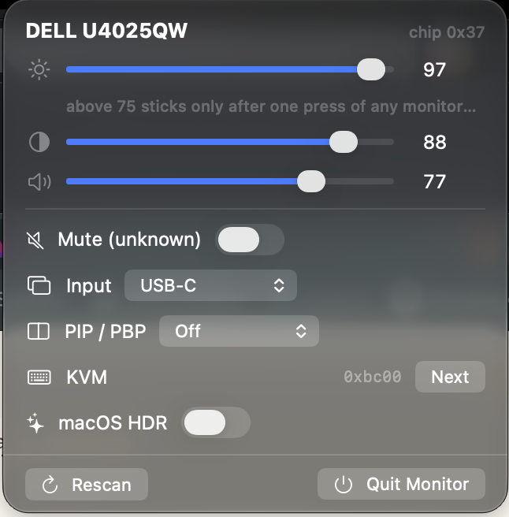

# monitor — DDC/CI control for external displays on Apple Silicon

Two faces over one shared protocol core:

- **Monitor** — a menu-bar app (no Dock icon): click the display icon and a
  compact panel opens under it with brightness/contrast/volume sliders,
  input switching, PIP/PBP, KVM, and a lock-aware macOS HDR toggle.
- **`ddcx` / `hdr`** — CLI tools with the same powers, for scripting and
  for when the GUI can't reach the screen.

Reverse-engineered from live protocol sessions on a Dell U4025QW after
`m1ddc` proved unreliable on it. The full protocol/implementation spec,
with evidence status for every claim, is **[SPEC.md](SPEC.md)**.



## Install

Grab `MonitorApp-1.0.0.zip` from [Releases][releases], unzip, and move
**Monitor.app** to `/Applications` (or anywhere — it's a menu-bar app with
no Dock icon; look for the display icon at the right end of the menu bar).

The binary is **unsigned** (no Apple Developer ID), so Gatekeeper will
question it on first launch: right-click the app → **Open** → **Open**,
or remove the quarantine bit once:

```
xattr -dr com.apple.quarantine /Applications/Monitor.app
```

The CLI tools (`ddcx`, `hdr`) are in `ddcx-hdr-macos-arm64.tar.gz` on the
same release — no Gatekeeper involvement for command-line binaries, but
they're arm64-only and need `make` from source for anything else.

[releases]: https://github.com/atkinson/monitor/releases

## Quick start

```
make                          # builds ./ddcx and ./hdr
./ddcx displays               # list DDC-capable external displays
./ddcx brightness            # → 75  (max 100)
./ddcx brightness 40         # set + checksum-verified read-back (exit 1 on failure)
./ddcx contrast 80
./ddcx volume 20
./ddcx input                  # → usb-c (Dell 0x19)   [also: input dp1|hdmi1|…]
./ddcx mute on|off            # (this panel: mute is not implemented — reads degenerate)
./ddcx kvm [next]             # Dell KVM (VCP 0xE7)
./ddcx pbp [off|small|large|5050|2674|7426|2x2]
./ddcx pbp-input [dp1|dp2|hdmi1|hdmi2]
./ddcx caps                   # monitor capabilities string (mangled on this panel)
./ddcx watch 10 10            # poll brightness for 10 s
./ddcx get|set <vcp-hex> [value]   # raw VCP access, checksum-validated
./ddcx raw|send <hex…>        # protocol diagnostics
./hdr                         # → DELL U4025QW: HDR off
./hdr on | ./hdr off          # toggle macOS HDR for external displays

open MonitorApp/MonitorApp.xcodeproj   # GUI — then ⌘R
```

Exit codes: `0` ok · `1` failure · `2` usage. Every write is verified by a
checksum-validated read-back; a transport ACK is never trusted as success.

## Which monitors does this work with?

The layers under the hood are **standard**, not Dell tricks:

| Layer | Portability |
|---|---|
| Transport (IOAVService I²C, 0x37 / 0xB7 on MCDP29xx bridges) | any external display on Apple Silicon |
| DDC/CI framing, checksums, rolling-stream reply parser | any conforming DDC/CI panel |
| Brightness 0x10 · contrast 0x12 · volume 0x62 · input 0x60 | VESA MCCS standard |
| Display discovery (framebuffer → DCPAVServiceProxy) | per-host, not per-monitor |

The app **probes each control live** (SPEC §5.4: known table ∪ caps hints ∩
probed reality) and only shows rows whose VCP answered with a real frame —
on a monitor without speakers you simply get no volume slider, without a
KVM no KVM row. Both USB-C input codes (this Dell's 0x19 and MCCS 0x1B)
are offered in the picker.

Dell-specific (hidden automatically when absent): KVM 0xE7, PIP/PBP
0xE8/0xE9. Dell-observed firmware behaviors that may or may not exist
elsewhere: the HDR write-lock (§6), the >75 energy confirmation (§6.4),
and same-code read-silence after layout writes (§9.3).

Untested on other hardware: everything above was verified on exactly one
U4025QW on one M2 Max host. Multi-display (`--display N`) is implemented
per SPEC §8 but only ever exercised with N=1. If you try another monitor,
`ddcx displays && ddcx caps && ddcx get 10` is the 30-second smoke test;
contributions of caps strings / quirks are welcome.

## The two firmware gates (why brightness sometimes "doesn't stick")

**1. macOS HDR lock (SPEC §6).** While macOS HDR is enabled for the
display, the monitor ACKs brightness/contrast/preset writes and then
silently drops them — reads, volume, input and KVM keep working. `ddcx`
detects this (volume-probe heuristic) and says so; the app locks the
affected sliders with a one-click **Release (disable macOS HDR)** button.
Release = `./hdr off`. Turning HDR back on re-locks brightness — that
trade is the monitor's firmware, not the tool.

**2. Energy confirmation above 75 (SPEC §6.4).** Raising brightness above
75 (the ENERGY STAR default) pops an on-monitor *"…will increase power
consumption, press any button to confirm"* dialog; unconfirmed, the value
reverts to 75 after ~15 s — *after* the DDC write has already verified ✓.
The app marks the threshold, explains the one physical button press, and
re-checks after the window to tell you whether it stuck. No VCP to
suppress the nag exists as far as probing found (`probes/`).

## Troubleshooting

- **Brightness write verifies ✓ then snaps back** → gate 2 above
  (confirm once on the monitor, or stay ≤ 75).
- **Brightness write ✗ / "HDR signal lock suspected"** → gate 1
  (`./hdr off`, or the app's Release button).
- **A PIP/PBP layout change hid the GUI** → the desktop re-arranges;
  the app re-centers itself, and the manual recovery is `./ddcx pbp off`.
- **"no external displays with DDC services discovered"** → virtual
  displays (AirPlay, some docks) have no DDC; check the cable is
  USB-C/DP/HDMI-direct.

## Why m1ddc gives garbage reads on this monitor (SPEC §7)

Replies arrive arbitrarily misaligned (0–8+ leading zero bytes), split
across reads, and stale-served. m1ddc parses fixed buffer offsets without
checksum validation, so it prints junk. `ddcx` accumulates a rolling
stream, scans for the `6E 8x` sync pattern, and validates every frame with
the XOR-0x50 reply checksum law.

## Layout & hacking

- `Sources/DDC.swift` — DDC/CI core (transport, framing, parser,
  discovery, lock heuristic); shared by CLI and GUI
- `Sources/HDR.swift` — MonitorPanel `preferHDRModes` read/toggle; shared
- `cli/ddcx-cli.swift`, `cli/hdr-cli.swift` — thin `@main` CLI fronts
  (`-parse-as-library`)
- `MonitorApp/` — the SwiftUI menu-bar app; compiles the SAME
  `Sources/*.swift` via file symlinks inside its synchronized folder
  (Xcode ignores symlinked directories but follows file symlinks — edit
  the files at `Sources/`)
- `probes/` — captured VCP scan evidence referenced by the SPEC

CLI front basenames must not case-collide with `Sources/` basenames:
swiftc names batch-mode objects after file basenames and APFS is
case-insensitive — `hdr.swift` vs `HDR.swift` silently overwrote each
other's objects and lost `main`.

## References

- SPEC: [SPEC.md](SPEC.md) — every layer with evidence status
- m1ddc (framing, MCDP29xx `0xB7`, Dell KVM/PBP values):
  https://github.com/waydabber/m1ddc
- DDC/CI + MCCS background: https://www.ddcutil.com/
- MonitorPanel HDR bindings after alin23's mac-utils (ToggleHDR.swift)

*Environment: Apple M2 Max, macOS (arm64), Dell U4025QW over
Thunderbolt/USB-C at 5120×2160@120. Written 2026-10.*

## License

MIT — see [LICENSE](LICENSE).
